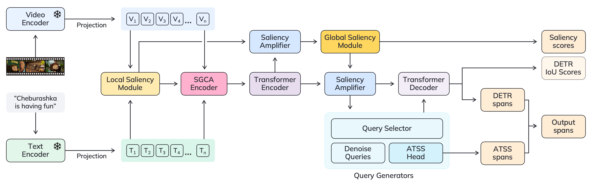

<div align="center">
<p>
<a align="left"  target="_blank">
</a>
</p>

<p><b>
Saliency-Guided DETR for Moment Retrieval and Highlight Detection
</b>
</p>
</div>

[[`Paper`](https://arxiv.org/abs/2410.01615)]


[](https://paperswithcode.com/sota/moment-retrieval-on-charades-sta?p=saliency-guided-detr-for-moment-retrieval-and) </br>
[](https://paperswithcode.com/sota/highlight-detection-on-qvhighlights?p=saliency-guided-detr-for-moment-retrieval-and) </br>
[](https://paperswithcode.com/sota/zero-shot-moment-retrieval-on-qvhighlights?p=saliency-guided-detr-for-moment-retrieval-and) </br>
[](https://paperswithcode.com/sota/moment-retrieval-on-qvhighlights?p=saliency-guided-detr-for-moment-retrieval-and) </br>
[](https://paperswithcode.com/sota/natural-language-moment-retrieval-on-tacos?p=saliency-guided-detr-for-moment-retrieval-and) </br>
[](https://paperswithcode.com/sota/highlight-detection-on-tvsum?p=saliency-guided-detr-for-moment-retrieval-and) </br>
[](https://paperswithcode.com/sota/highlight-detection-on-youtube-highlights?p=saliency-guided-detr-for-moment-retrieval-and) </br>


### <div align="center">Documentation</div>
---

<details open>
<summary style="font-size: larger;">Abstract</summary>

With the rapid growth of video content available, the ability to search for specific moments within videos using textual queries has become increasingly relevant. This is crucial in many scenarios, from surveillance cameras where it may be necessary to find specific events in extensive video streams to searching for exciting movie scenes. However, existing approaches for video Moment Retrieval and Highlight Detection often struggle to effectively align text and video features, limiting their performance. We argue that utilizing recent foundational video models designed for video-text alignment can overcome these limitations. We propose a novel architecture that utilizes such models to test this hypothesis. Combined with our novel Saliency-Guided Cross Attention mechanism and a hybrid DETR architecture, our approach provides significantly improved results. To further enhance our approach, we developed InterVid-MR — a large-scale, high-quality dataset specifically designed for a pretraining stage. We conducted extensive experiments and comparisons with current state-of-the-art methods, demonstrating that our architecture achieves superior results on the QVHighlights, Charades-STA, and TACoS benchmarks. The proposed approach provides an efficient and scalable solution for both zero-shot and fine-tuning scenarios in video-language tasks. The dataset and code will be publicly available.
</details>

</br>

<details open>
<summary style="font-size: larger;">Install</summary>

Make sure you have [**Python>=3.10.0**](https://www.python.org/) installed and follow these steps:

```bash
$ cd mr_train_repo
$ python3.10 -m venv venv
$ pip install -r requirements-dev.txt
$ pip install -e .
```

To run docker container
```bash
# set your own paths to project and data
# -c - your device compute capability
# -i - gpu id
# -b - whether to run build or use existing image
scripts/run_docker_base.sh -c 70 -i 0 -b true
```
</details>

</br>

<details open>
<summary style="font-size: larger;">Datasets</summary>

We provide the following pre-extracted features for your convenience:

| Dataset                          | Link                                                                                                   |
|----------------------------------|--------------------------------------------------------------------------------------------------------|
| InterVidV2-1b QVHighlights Features | [Google Drive](https://drive.google.com/file/d/15R0uunpaq7JhSSSZv5GPUiv409GvlGLU/view?usp=sharing)                                                                                              |
| InterVidV2-1b TVSum Features        | [Google Drive](https://drive.google.com/drive/folders/1iQSeSwPCtg_KbDE_Z_fgnPQ_n8JHQQi7?usp=sharing)   |
| InterVidV2-1b YouTubeHL Features    | [Google Drive](https://drive.google.com/drive/folders/1G2cpX5MY-m_oBx4R0V1XdrNBDoG5fRB1?usp=sharing)   |
| InterVidV2-1b TACoS Features        | [Google Drive](https://drive.google.com/drive/folders/1tuLZq67v8rMAtiYv5V2B3otdhwuasPN-?usp=sharing)   |
| InterVidV2-1b Charades Features     | [Google Drive](https://drive.google.com/drive/folders/13hVI7Ce2rXANHw3P-ai5L7Btq2Sxewh4?usp=sharing)   |
|InterVidV2-1b Pretrain Features|[Google Drive](https://drive.google.com/drive/folders/1R2mJd-AXiTHepLAimCr0zO9g7fr0JBny?usp=sharing)|

If you wish to extract custom features, we offer this [repo](features-extractor/README.md) for feature extraction.
</details>

</br>

<details open>
<summary style="font-size: larger;">Run experiment</summary>

We use [Hydra](https://www.something.org/) to configure runs. Below are the commands to train models on different datasets.

#### Prerequisites:
Before running the experiments, increase the file descriptor limit:
```bash
ulimit -n 128000
```

#### Training Commands:

- **Train on QVHighlights**
  ```bash
  python src/cli/train.py --config-name train.yaml
  ```

- **Train on Charades**
  ```bash
  python src/cli/train.py --config-name train_charades.yaml
  ```

- **Train on TACoS**
  ```bash
  python src/cli/train.py --config-name train_tacos.yaml
  ```


- **Train on TVSum**
  ```bash
  ./scripts/train_tvsum.sh
  ```

- **Train on YoutubeHL**
  ```bash
  ./scripts/train_youtube.sh
  ```

</details>

</br>

<details open>
<summary style="font-size: larger;">Model Zoo</summary>

The following pre-trained models are available for your use:

| Model                  | Link                                                                                                      |
|------------------------|-----------------------------------------------------------------------------------------------------------|
| QVHighlights           | [Google Drive](https://drive.google.com/file/d/1BbPEV13fnyzFJqNdP3GtgJ3TsbGDLuVT/view?usp=sharing)        |
| QVHighlights w/ PT     | [Google Drive](https://drive.google.com/file/d/1KFuLQHPvoCExCDG-P7VByd5fOtFQ3x8S/view?usp=sharing)        |
| TACoS                  | [Google Drive](https://drive.google.com/file/d/1YZA-CG2tJLRSki5KUfuuikJ7nXsJ-ByY/view?usp=sharing)        |
| TACoS w/ PT            | [Google Drive](https://drive.google.com/file/d/1HdZ-4mP28qfAiBFporLXY7JLpkneQkZp/view?usp=sharing)        |
| Charades               | [Google Drive](https://drive.google.com/file/d/1KShUx5GmYncHLvhUw4Hc6XAencm-OSZ7/view?usp=sharing)        |
| Charades w/ PT         | [Google Drive](https://drive.google.com/file/d/1-fUDhgj408m0INlZS4ILEh1bb27T2v5y/view?usp=sharing)        |

</details>

### License
SG-DETR is released under the Apache-2.0 license.

See the file [LICENSE](LICENSE.txt) for more details.

### Citing

If you use our models, code or dataset, we kindly request you to cite our paper and give repository a ⭐

```bibtex
@article{sg-detr,
Author = {Aleksandr Gordeev and Vladimir Dokholyan and Irina Tolstykh and Maksim Kuprashevich},
Title = {Saliency-Guided DETR for Moment Retrieval and Highlight Detection},
Year = {2024},
Eprint = {arXiv:2410.01615},
```
